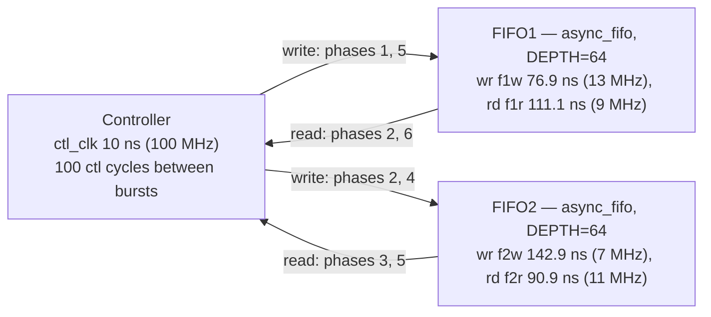

# Configurable Async FIFO

Synthesizable SystemVerilog asynchronous FIFO with independent write, read, and configuration clocks, Gray-code CDC, programmable warning thresholds, and selectable active depth.

## Features

- Independent `wr_clk`, `rd_clk`, and `cfg_clk` (any frequency relationship)
- Gray-coded pointers with two-stage synchronizers
- Asynchronous reset assertion, synchronous release per clock domain
- Registered read output; dual-port RAM inference
- Programmable `almost_empty` and `almost_full`
- Runtime active depth: 100%, 75%, 50%, or 25% of `DEPTH`
- Gray-encoded configuration CDC
- Maskable level interrupt for full, empty, almost-full, and almost-empty
- Sticky overflow/underflow status with acknowledged write-one-to-clear
- Configuration and approximate occupancy readback
- Cross-domain flush command with busy handshake and pointer-resynchronization gating
- Directed, randomized, boundary, and coverage tests
- Dedicated flush-resume CDC regression (`tb/tb_flush_hazard.sv`)
- Two-FIFO controller-chain simulation with a dedicated clock per port (`tb/tb_two_fifo.sv`)
- APB, AHB-Lite, and AXI-Stream/AXI4-Lite bus wrappers around the unchanged core,
  sharing a combinational `fifo_apb_cfg` register bridge
- Dedicated wrapper testbenches with wait-state, MODE-switch, and backpressure checks

## Quick Start

Requirements: Icarus Verilog and/or Verilator. `make sim` and the coverage targets
additionally need `verilator_coverage` on `PATH`; some Verilator packages (for
example the conda-forge build) do not install it, in which case the simulation
passes and only the trailing coverage-report step fails.

```bash
make lint            # RTL lint
make iverilog        # functional + flush-hazard + two-FIFO + 3 wrapper TBs (Icarus)
make two-fifo        # two-FIFO controller-chain simulation (DEPTH=64) only
make sim             # Verilator simulation + combined coverage data
make coverage-report # separate line/toggle reports
```

Latest verified results (commit `ff8ada2`, 2026-11-24). Functional tests use
`DW=8`, `DEPTH=16`, wr 100 MHz / rd 62.5 MHz / cfg 166.7 MHz:

- Functional tests: all passed, 0 errors; 334 writes and 282 reads modeled and checked
- Flush-resume regression (wr 5 MHz / rd 50 MHz / cfg 500 MHz): passed
- Two-FIFO chain (`DEPTH=64`, 64-word bursts; ctl 100 MHz, f1w 13 MHz,
  f1r 9 MHz, f2w 7 MHz, f2r 11 MHz; 100 ctl cycles between bursts): passed,
  0 errors; 512 transfers total (128 writes and 128 reads per FIFO), 256 read
  words compared, ~65 µs of simulated time; waveform in `sim/tb_two_fifo.vcd`
- Wrapper testbenches (`make iverilog`; APB `pclk` 100 MHz, AHB `hclk` 100 /
  `cfg_clk` 71.4 / ext `wr_clk` 25 / ext `rd_clk` 38.5 MHz, AXI-Stream `aclk` 83.3 /
  `s_axis_aclk` 100 / `m_axis_aclk` 71.4 MHz): APB 36 pushes / 36 pops, AHB 30
  writes / 29 reads, AXI-Stream 15 words in / 15 out, all 0 errors; the APB and AHB
  stall probes held `PREADY`/`HREADYOUT` low for 7 cycles before the test aborted the
  transfer, every pop adds exactly one wait state, and AXI-Stream `m_axis_tvalid` was
  high in 10/10 consecutive cycles with `tready` held high
- `make lint`: no errors for `async_fifo` and the four wrapper RTL files; the only
  warnings are `UNUSEDSIGNAL` on intentionally unused bus bits and the core's
  pre-existing `SYNCASYNCNET`, both tolerated by `-Wno-fatal`
- Depth modes: 4/4
- Almost-flag transitions: 4/4
- Boundary cases: 4/4

The coverage and FORMAL figures below predate the wrappers and were not re-measured
here: `sim/run_verilator.sh` compiles only `rtl/async_fifo.sv` and
`tb/tb_async_fifo.sv`, so the wrappers cannot change them, and `verilator_coverage`
is not installed in this environment.

- Line coverage: 613/616 (99.5%) over RTL + testbench; the only uncovered RTL line is
  the `DEPTH < 4` parameter warning
- Toggle coverage: 81/81 (100.0%)
- FORMAL variant (`iverilog -g2012 -gsupported-assertions -DFORMAL`) compiles clean

## Parameters

| Parameter | Default | Description |
|---|---:|---|
| `DW` | 8 | Data width |
| `DEPTH` | 16 | Physical FIFO depth; power of two, at least 2 |
| `ADDR_W` | `$clog2(DEPTH)` | Address width; must equal `$clog2(DEPTH)` |

Checks run at time 0: a non-power-of-two or `DEPTH < 2` fails elaboration with
`$fatal`, a mismatched `ADDR_W` fails with `$fatal`, and `DEPTH < 4` warns because
the 25% depth mode then degenerates.

## Ports

| Signal | Dir | Domain | Description |
|---|---|---|---|
| `wr_clk` | I | write | Write clock |
| `wr_rst_n` | I | write | Active-low; async assert, synchronized release |
| `wr_en` | I | write | Write request; ignored when `full` |
| `wr_data[DW-1:0]` | I | write | Write data |
| `full` | O | write | Active-depth limit reached |
| `almost_full` | O | write | Occupancy at/above configured threshold |
| `rd_clk` | I | read | Read clock |
| `rd_rst_n` | I | read | Active-low; async assert, synchronized release |
| `rd_en` | I | read | Read request; ignored when `empty` |
| `rd_data[DW-1:0]` | O | read | Registered read data |
| `empty` | O | read | No readable entries |
| `almost_empty` | O | read | Occupancy at/below configured threshold |
| `cfg_clk` | I | config | Configuration clock |
| `cfg_rst_n` | I | config | Active-low; async assert, synchronized release |
| `cfg_we` | I | config | Configuration write enable |
| `cfg_re` | I | config | Configuration read enable; gates `cfg_rdata` |
| `cfg_addr[3:0]` | I | config | Register address |
| `cfg_wdata[ADDR_W:0]` | I | config | Register write data |
| `cfg_rdata[ADDR_W:0]` | O | config | Combinational register read data; zero when `cfg_re=0` |
| `irq` | O | config | OR of enabled interrupt status bits |
| `wr_ptr_gray_sync[ADDR_W:0]` | O | read | Write pointer synchronized into read domain |
| `rd_ptr_gray_sync[ADDR_W:0]` | O | write | Read pointer synchronized into write domain |

## Configuration Registers

| Address | Register | Access | Reset | Data |
|---:|---|---|---:|---|
| `0` | Almost-empty threshold | R/W | `ceil(20% × DEPTH)` | Entry count; writes above `DEPTH` saturate |
| `1` | Almost-full threshold | R/W | `ceil(80% × DEPTH)` | Entry count; writes above `DEPTH` saturate |
| `2` | Active depth | R/W | `DEPTH` | Write selector `[1:0]`: `0`=100%, `1`=75%, `2`=50%, `3`=25%; read returns the entry count from a `cfg_clk`-synchronized copy |
| `3` | IRQ mask | R/W | `0` | `[0]` full, `[1]` empty, `[2]` almost-full, `[3]` almost-empty; `1` enables source |
| `4` | IRQ status | R | dynamic | Bit assignment matches IRQ mask |
| `5` | Sticky errors | R/W1C | `0` | `[0]` overflow, `[1]` underflow; write `1` to clear; ignored until the previous clear is acknowledged |
| `6` | Write occupancy | R | `0` | Approximate entry count sampled in `cfg_clk` |
| `7` | Read occupancy | R | `0` | Approximate entry count sampled in `cfg_clk` |
| `8` | Flush control/status | R/W | `0` | Write `[0]=1` to request flush; read `[0]` as busy |
| `9` | MODE (AHB wrapper only) | R/W | `0` | Wrapper-local, not implemented in the core (reads `0` there): `0` = AHB pushes and pops, `1` = AHB pushes with the raw read port on `rd_clk`, `2` = AHB pops with the raw write port on `wr_clk`, `3` = reserved, behaves as `0` |

`irq = |(irq_status & irq_mask)`. Status sources are synchronized levels, so assertion/deassertion has CDC latency. Sticky errors do not currently feed `irq`.

Flush resets both data-domain pointers through a request/acknowledge toggle handshake. Each domain resets its pointer, holds traffic, and only then acknowledges; the acknowledge is delayed until the synchronized peer pointer reads zero, so `flush_busy` covers the whole resynchronization window. A write or read request issued during that window is dropped and sets the corresponding sticky overflow/underflow bit (clear it through address `5`). Do not issue another flush while busy; such writes are ignored. FIFO memory is not erased, but flushed entries become inaccessible.

Sticky clear is a toggle request/acknowledge handshake as well. A W1C write issued while a previous clear is still in flight (acknowledge not yet returned) is ignored rather than queued, so back-to-back writes cannot drop or wedge a clear. Poll address `5` and retry if needed.

A request dropped by a flush window can also set a sticky bit that no real data error caused: a dropped write sets overflow while `full` is still stale-high, and a dropped read always sets underflow because `empty` is forced during the window. Read address `5` and clear it through the same W1C path before treating the FIFO as error-free.

Change active depth only while the FIFO is empty. Software must ensure the almost-full threshold is sensible for the selected active depth.

Change MODE only while the affected data-domain reset is asserted: assert `wr_rst_n` and/or `rd_rst_n`, write MODE through the AHB wrapper's APB port, then release. The wrapper clock muxes are plain combinational muxes with no live-switch protection, so a mode change with running data clocks is not supported. Switch with the FIFO empty and the AHB bus idle.

Configuration values are converted to Gray code in `cfg_clk`, synchronized through two registers, then decoded in the destination domain. See [doc/design.md](doc/design.md) for CDC assumptions and integration constraints.

## Bus Wrappers

Three wrappers drive the unchanged core. Bus data is 32 bits wide: a push takes the
low `DW` bits of the write data, and a pop returns zero-extended data. Configuration
registers are decoded from word offset `[5:2]`. A pop always costs one wait state
because the core read data is registered. A push while `full` or a pop while `empty`
stalls the transfer (no error response) rather than dropping data; since these
wrappers own the only path that could free space, software must poll IRQ status
(register `4`) before a transfer that could stall.

| Wrapper | File | Data interface | Config interface | Clocking |
|---|---|---|---|---|
| APB | `rtl/fifo_apb_wrapper.sv` | one APB slave, `paddr[8]=0` register window (`0x000`–`0x03C`), `paddr[8]=1` data window (`0x100`): write = push, read = pop | same port, register window | whole core on `pclk` |
| AHB | `rtl/fifo_ahb_wrapper.sv` | AHB-Lite slave, single data window: write = push, read = pop | separate APB slave | `hclk` for the AHB side, `cfg_clk` for config, `wr_clk`/`rd_clk` for a raw side released by MODE |
| AXI-Stream | `rtl/fifo_axis_wrapper.sv` | `s_axis` (push) and `m_axis` (pop), independent clocks | AXI4-Lite slave on `aclk` | `s_axis_aclk`, `m_axis_aclk`, `aclk` |

All three wrappers take the core's `DW` and `DEPTH` (with `ADDR_W = $clog2(DEPTH)`)
and are verified at `DW=8`, `DEPTH=16`. Their bus data ports are fixed at 32 bits;
making a bus as narrow as `DW` is a port-list edit, not a parameter.

`rtl/fifo_apb_cfg.sv` is the shared, purely combinational APB-to-`cfg_*` bridge: one
cycle access phase, `PREADY` constant `1`, all 16 word offsets forwarded, and the
core ignores reserved offsets through its existing `default:` arm.

APB and AHB wrappers: a data-window push completes in the single access/data phase
while `!full`; a pop issues `rd_en`, holds `PREADY`/`HREADYOUT` low for one cycle,
then returns the popped word. In MODE 0 the AHB engine owns both FIFO ports; in MODE
1 the raw read port is exposed on `rd_clk` and AHB reads complete with zero data
without popping; in MODE 2 the raw write port is exposed on `wr_clk` and AHB writes
complete without pushing. The AHB engine relies on `full`/`empty` always coming from
the side it currently owns, which the MODE mux guarantees.

`hresetn` resets only the AHB engine (latched request and read-capture state), not the
FIFO: a permanently stalled data phase is abandoned by asserting `hresetn`, and FIFO
contents survive as long as `wr_rst_n`/`rd_rst_n` stay high. A single-slave system ties
`hready` to `hreadyout`. `haddr`, `hsize`, and `htrans[0]` are ignored; only
`HTRANS[1]` (NONSEQ/SEQ) starts a transfer, and every transfer is a full 32-bit word.

AXI-Stream wrapper: `s_axis_tready = !full`, `wr_en = tvalid && tready`. The `m_axis`
side is a two-entry output pipeline — the core's registered `rd_data` as stage 1 and a
skid register as stage 2 — with a direct bypass, so `m_axis_tvalid` stays high on
consecutive cycles while `tready` is high and backpressure never loses or duplicates a
word. There is no TLAST/TKEEP/TSTRB: the FIFO carries no packet boundaries.

AXI4-Lite writes latch `AW` and `W` independently and execute once both are present;
`B` is held until `BREADY`. Reads accept one outstanding `AR`, return the
combinational register value registered into `RDATA`, and hold `RVALID` until
`RREADY`. Both responses are always `OKAY`; reserved offsets are forwarded and
ignored.

## Two-FIFO Chain Simulation

`tb/tb_two_fifo.sv` (`make two-fifo`) instantiates two `async_fifo` DUTs and one
behavioral controller. Every FIFO port runs on its own clock, so both DUTs' Gray
CDC is exercised. Each FIFO is accessed in back-to-back bursts: every word in a
burst is transferred on consecutive target-port cycles, and the controller waits
100 `ctl_clk` cycles (1 µs at 100 MHz) between a completed burst of writes and the
following burst of reads, or a completed burst of reads and the following burst
of writes.



Phase 1 fills FIFO1 with random words, phase 2 drains FIFO1 into the controller's
move buffer and refills FIFO2 from it, phase 3 reads FIFO2 back. Phase 4 fills
FIFO2 with ascending words, phase 5 drains FIFO2 into the buffer and refills
FIFO1, phase 6 reads FIFO1 back. Every read word is compared against the
`exp1`/`exp2` expected-data queues; phase 7 checks both DUTs are empty with
balanced pointers. The run dumps full-depth waveforms to `sim/tb_two_fifo.vcd`.
Measured from that dump: bursts of 64 accesses spaced exactly one port clock
(f1w 76.92 ns, f1r 111.11 ns, f2w 142.86 ns, f2r 90.91 ns), burst boundaries
≥ 1.1 µs apart.

## Repository Layout

```text
rtl/async_fifo.sv        FIFO RTL
rtl/fifo_apb_cfg.sv      Combinational APB-to-cfg register bridge
rtl/fifo_apb_wrapper.sv  APB slave wrapper (register window + data window)
rtl/fifo_ahb_wrapper.sv  AHB-Lite data slave + APB config port + MODE muxing
rtl/fifo_axis_wrapper.sv AXI-Stream (s_axis/m_axis) + AXI4-Lite config slave
tb/tb_async_fifo.sv      Self-checking testbench
tb/tb_flush_hazard.sv    Flush-resume CDC regression
tb/tb_two_fifo.sv        Two-FIFO controller-chain simulation
tb/tb_apb_wrapper.sv     APB wrapper testbench
tb/tb_ahb_wrapper.sv     AHB wrapper testbench (includes MODE 1/2/3)
tb/tb_axis_wrapper.sv    AXI-Stream wrapper testbench
sim/run_iverilog.sh      Icarus runner
sim/run_verilator.sh     Verilator coverage runner
sim/sim_main.cpp         Verilator coverage harness
sim/coverage_report.py   Line/toggle summary
fpga/constraints.sdc     Example CDC constraints
doc/design.md            Design and integration details
```

## Notes

- `rd_data` updates on an accepted read clock edge.
- Status, occupancy, and active-depth readback use synchronized pointers/signals; all are intentionally approximate by synchronizer latency.
- Apply CDC timing constraints and preserve `ASYNC_REG` chains in implementation.
- Coverage reporting needs `verilator_coverage` on `PATH`; it is not part of every Verilator package.
- No license file currently exists; add one before redistribution if required.

## References

- C. E. Cummings, “Simulation and Synthesis Techniques for Asynchronous FIFO Design,” SNUG 2002.
- C. E. Cummings, “Synthesis and Scripting Techniques for Designing Multi-Asynchronous Clock Designs,” SNUG 2002.
