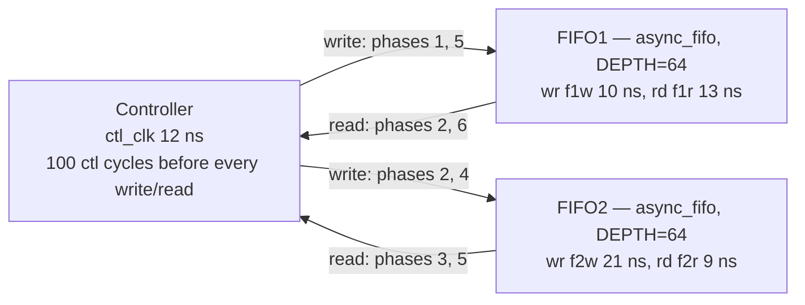

# Configurable Async FIFO

Synthesizable SystemVerilog asynchronous FIFO with independent write, read, and configuration clocks, Gray-code CDC, programmable warning thresholds, and selectable active depth.

## Features

- Independent `wr_clk`, `rd_clk`, and `cfg_clk` (any frequency relationship)
- Gray-coded pointers with two-stage synchronizers
- Asynchronous reset assertion, synchronous release per clock domain
- Registered read output; dual-port RAM inference
- Programmable `almost_empty` and `almost_full`
- Runtime active depth: 100%, 75%, 50%, or 25% of `DEPTH`
- Gray-encoded configuration CDC
- Maskable level interrupt for full, empty, almost-full, and almost-empty
- Sticky overflow/underflow status with acknowledged write-one-to-clear
- Configuration and approximate occupancy readback
- Cross-domain flush command with busy handshake and pointer-resynchronization gating
- Directed, randomized, boundary, and coverage tests
- Dedicated flush-resume CDC regression (`tb/tb_flush_hazard.sv`)

## Quick Start

Requirements: Icarus Verilog and/or Verilator. The coverage targets additionally
need `verilator_coverage` on `PATH` (it ships with Verilator).

```bash
make lint            # RTL lint
make iverilog        # functional + flush-hazard + two-FIFO chain (Icarus)
make two-fifo        # two-FIFO controller-chain simulation (DEPTH=64) only
make sim             # Verilator simulation + combined coverage data
make coverage-report # separate line/toggle reports
```

Latest verified results (commit `8aed8ea`, 2026-11-24). Functional tests use
`DW=8`, `DEPTH=16`, wr 100 MHz / rd 62.5 MHz / cfg 166.7 MHz:

- Functional tests: all passed, 0 errors; 334 writes and 282 reads modeled and checked
- Flush-resume regression (wr 5 MHz / rd 50 MHz / cfg 500 MHz): passed
- Two-FIFO chain (`DEPTH=64`, 64 words per direction, ctl 12 ns / f1w 10 ns /
  f1r 13 ns / f2w 21 ns / f2r 9 ns, 100 ctl cycles before every access): passed,
  0 errors; 128 writes and 128 reads per FIFO, 512 compared transfers, ~619 µs
  of simulated time; waveform in `sim/tb_two_fifo.vcd`
- Depth modes: 4/4
- Almost-flag transitions: 4/4
- Boundary cases: 4/4
- Line coverage: 613/616 (99.5%) over RTL + testbench; the only uncovered RTL line is
  the `DEPTH < 4` parameter warning
- Toggle coverage: 81/81 (100.0%)
- FORMAL variant (`iverilog -g2012 -gsupported-assertions -DFORMAL`) compiles clean

## Parameters

| Parameter | Default | Description |
|---|---:|---|
| `DW` | 8 | Data width |
| `DEPTH` | 16 | Physical FIFO depth; power of two, at least 2 |
| `ADDR_W` | `$clog2(DEPTH)` | Address width; must equal `$clog2(DEPTH)` |

Checks run at time 0: a non-power-of-two or `DEPTH < 2` fails elaboration with
`$fatal`, a mismatched `ADDR_W` fails with `$fatal`, and `DEPTH < 4` warns because
the 25% depth mode then degenerates.

## Ports

| Signal | Dir | Domain | Description |
|---|---|---|---|
| `wr_clk` | I | write | Write clock |
| `wr_rst_n` | I | write | Active-low; async assert, synchronized release |
| `wr_en` | I | write | Write request; ignored when `full` |
| `wr_data[DW-1:0]` | I | write | Write data |
| `full` | O | write | Active-depth limit reached |
| `almost_full` | O | write | Occupancy at/above configured threshold |
| `rd_clk` | I | read | Read clock |
| `rd_rst_n` | I | read | Active-low; async assert, synchronized release |
| `rd_en` | I | read | Read request; ignored when `empty` |
| `rd_data[DW-1:0]` | O | read | Registered read data |
| `empty` | O | read | No readable entries |
| `almost_empty` | O | read | Occupancy at/below configured threshold |
| `cfg_clk` | I | config | Configuration clock |
| `cfg_rst_n` | I | config | Active-low; async assert, synchronized release |
| `cfg_we` | I | config | Configuration write enable |
| `cfg_re` | I | config | Configuration read enable; gates `cfg_rdata` |
| `cfg_addr[3:0]` | I | config | Register address |
| `cfg_wdata[ADDR_W:0]` | I | config | Register write data |
| `cfg_rdata[ADDR_W:0]` | O | config | Combinational register read data; zero when `cfg_re=0` |
| `irq` | O | config | OR of enabled interrupt status bits |
| `wr_ptr_gray_sync[ADDR_W:0]` | O | read | Write pointer synchronized into read domain |
| `rd_ptr_gray_sync[ADDR_W:0]` | O | write | Read pointer synchronized into write domain |

## Configuration Registers

| Address | Register | Access | Reset | Data |
|---:|---|---|---:|---|
| `0` | Almost-empty threshold | R/W | `ceil(20% × DEPTH)` | Entry count; writes above `DEPTH` saturate |
| `1` | Almost-full threshold | R/W | `ceil(80% × DEPTH)` | Entry count; writes above `DEPTH` saturate |
| `2` | Active depth | R/W | `DEPTH` | Write selector `[1:0]`: `0`=100%, `1`=75%, `2`=50%, `3`=25%; read returns the entry count from a `cfg_clk`-synchronized copy |
| `3` | IRQ mask | R/W | `0` | `[0]` full, `[1]` empty, `[2]` almost-full, `[3]` almost-empty; `1` enables source |
| `4` | IRQ status | R | dynamic | Bit assignment matches IRQ mask |
| `5` | Sticky errors | R/W1C | `0` | `[0]` overflow, `[1]` underflow; write `1` to clear; ignored until the previous clear is acknowledged |
| `6` | Write occupancy | R | `0` | Approximate entry count sampled in `cfg_clk` |
| `7` | Read occupancy | R | `0` | Approximate entry count sampled in `cfg_clk` |
| `8` | Flush control/status | R/W | `0` | Write `[0]=1` to request flush; read `[0]` as busy |

`irq = |(irq_status & irq_mask)`. Status sources are synchronized levels, so assertion/deassertion has CDC latency. Sticky errors do not currently feed `irq`.

Flush resets both data-domain pointers through a request/acknowledge toggle handshake. Each domain resets its pointer, holds traffic, and only then acknowledges; the acknowledge is delayed until the synchronized peer pointer reads zero, so `flush_busy` covers the whole resynchronization window. A write or read request issued during that window is dropped and sets the corresponding sticky overflow/underflow bit (clear it through address `5`). Do not issue another flush while busy; such writes are ignored. FIFO memory is not erased, but flushed entries become inaccessible.

Sticky clear is a toggle request/acknowledge handshake as well. A W1C write issued while a previous clear is still in flight (acknowledge not yet returned) is ignored rather than queued, so back-to-back writes cannot drop or wedge a clear. Poll address `5` and retry if needed.

A request dropped by a flush window can also set a sticky bit that no real data error caused: a dropped write sets overflow while `full` is still stale-high, and a dropped read always sets underflow because `empty` is forced during the window. Read address `5` and clear it through the same W1C path before treating the FIFO as error-free.

Change active depth only while the FIFO is empty. Software must ensure the almost-full threshold is sensible for the selected active depth.

Configuration values are converted to Gray code in `cfg_clk`, synchronized through two registers, then decoded in the destination domain. See [doc/design.md](doc/design.md) for CDC assumptions and integration constraints.

## Two-FIFO Chain Simulation

`tb/tb_two_fifo.sv` (`make two-fifo`) instantiates two `async_fifo` DUTs and one
behavioral controller. Every FIFO port runs on its own clock, so both DUTs' Gray
CDC is exercised; the controller waits 100 `ctl_clk` cycles before each access.



Phase 1 fills FIFO1 with random words, phase 2 moves them into FIFO2, phase 3
reads FIFO2 back. Phase 4 fills FIFO2 with ascending words, phase 5 moves them
into FIFO1, phase 6 reads FIFO1 back. Every transferred word is compared against
the `exp1`/`exp2` expected-data queues; phase 7 checks both DUTs are empty with
balanced pointers. The run dumps full-depth waveforms to `sim/tb_two_fifo.vcd`.

## Repository Layout

```text
rtl/async_fifo.sv       FIFO RTL
tb/tb_async_fifo.sv     Self-checking testbench
tb/tb_flush_hazard.sv   Flush-resume CDC regression
tb/tb_two_fifo.sv       Two-FIFO controller-chain simulation
sim/run_iverilog.sh     Icarus runner
sim/run_verilator.sh    Verilator coverage runner
sim/sim_main.cpp        Verilator coverage harness
sim/coverage_report.py  Line/toggle summary
fpga/constraints.sdc    Example CDC constraints
doc/design.md           Design and integration details
```

## Notes

- `rd_data` updates on an accepted read clock edge.
- Status, occupancy, and active-depth readback use synchronized pointers/signals; all are intentionally approximate by synchronizer latency.
- Apply CDC timing constraints and preserve `ASYNC_REG` chains in implementation.
- Coverage reporting needs `verilator_coverage` on `PATH` (installed with Verilator).
- No license file currently exists; add one before redistribution if required.

## References

- C. E. Cummings, “Simulation and Synthesis Techniques for Asynchronous FIFO Design,” SNUG 2002.
- C. E. Cummings, “Synthesis and Scripting Techniques for Designing Multi-Asynchronous Clock Designs,” SNUG 2002.
